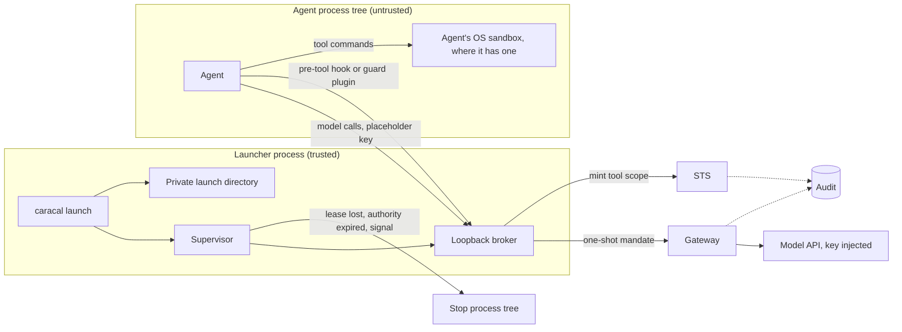

Caracal governs software in two ways. Your own services use an SDK. CLI agents such as Claude Code and OpenClaw cannot be rebuilt around one, so [`caracal launch`](/guides/runtime-launch/) runs them in a governed runtime instead. Both use the same Sessions, Delegations, mandates, Gateway, STS, and audit, because the launcher's broker is the SDK running outside the agent's process.

## Runtime Design

| Component | Responsibility |
| --- | --- |
| Supervisor | Runs preflight checks, starts the launcher and agent Sessions, delegates tool scopes, keeps the heartbeat, and stops the agent when its authority ends. |
| Broker | Sends model calls through the Gateway, answers tool decisions, and holds model calls until a required guard has loaded. Its URL carries a per-launch secret and is kept out of process command lines. |
| Adapter | Holds what is specific to one agent: how to launch it, how to route it through the broker, how its hook answers, which flags are refused, what it needs on each platform, and which versions were verified. |
| Process boundary | The single place that spawns, signals, and stops whole process trees on each operating system. |

A new agent needs one adapter. Its behavior has to be measured against the real binary, especially what happens when a hook fails and what can switch the hook off.

## SDK And CLI Integration

| | SDK | `caracal launch` |
| --- | --- | --- |
| Fits | Services you build | CLI agents you cannot rebuild |
| Code changes | Required | None |
| Application secret | Held by the application | Held by the launcher, never by the agent |
| Model and API calls | Gateway and STS on every request | Gateway and STS on every request, through the broker |
| Tool calls | Decided by the application | Decided at STS on every call, through a hook or plugin |
| Revocation | Next request | Next request, and the process tree stops |

## What Is Enforced

| Operation | Enforced | By |
| --- | --- | --- |
| Calls to registered Resources | Yes | Gateway and STS on every request. Credentials never reach the agent. |
| Revoked authority | Yes, on the next call | STS |
| Built-in and MCP tool calls | Yes, cooperatively | The agent's hook or plugin, decided at STS. An agent that ignored its hooks would not be governed for tools. |
| Direct network access from shell commands | Only with an OS sandbox | Claude Code's sandbox. OpenClaw's commands are not sandboxed. |
| Reading credential stores from shell commands | Only with an OS sandbox | Deny rules through Claude Code's sandbox. OpenClaw's commands are not sandboxed. |
| Other files the user can read | No | Deny rules only cover known credential stores. |
| What an allowed command does in the workspace | No | Limited by the sandbox where there is one. |
| Content of allowed model calls | No | Not inspected. |

## Failure Handling

| Failure | Result |
| --- | --- |
| Hook crashes, hangs, or cannot reach the broker | The tool does not run. |
| Governance-disabling flag or settings file | The flag is refused, and the launcher's settings outrank agent-writable files. |
| Host managed settings switch off the hook or sandbox | The launch is refused, including when those settings cannot be read. |
| Agent version older than verified, or unreadable | The launch is refused. A newer version gets a warning. |
| STS or Gateway is down | No model call or tool decision succeeds, so no tool runs. |
| Coordinator is down | A short outage does not disturb the agent. Once the 2-minute lease lapses, STS refuses the Session. |
| Agent crashes | Its Sessions close, its process tree is stopped, and the launch directory is removed. |
| Launcher is killed with `SIGKILL` | The agent keeps running but can no longer reach the model or get a tool approved. Stop it yourself. |

## Compatibility

| | Linux | macOS | Windows |
| --- | --- | --- | --- |
| Claude Code: model, tools, stop | Tested | Not tested | Refused, because it has no sandbox there |
| Claude Code: command sandbox | Tested, needs `bubblewrap` and `socat` | Designed for Seatbelt, not tested | Refused |
| OpenClaw: model, tools, stop | Tested | Not tested | Not tested |
| OpenClaw: command sandbox | Not provided | Not provided | Not provided |
| Process tree stop | Tested | Same code path, not tested | `taskkill /T /F`, unit tested only |
