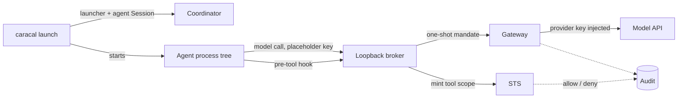

`caracal launch` runs a supported agent, Claude Code or OpenClaw, inside a Caracal-governed runtime. The agent receives no Caracal credential and no provider credential. Its model calls go through a loopback broker to the Gateway, which injects the provider key, and each tool call the agent is about to make is decided by Caracal first. The agent runs under a delegated agent Session, so terminating or revoking that Session stops the agent and every process it started.

Use it for coding and autonomous agents that you run as CLIs and cannot rebuild around an SDK. For a script that only needs provider credentials in its environment, use [`caracal run`](/guides/runtime-run/); for your own services, use an SDK transport.



## What is enforced

| Agent action | Governed by | Notes |
| --- | --- | --- |
| Model calls | Gateway and STS on every request | The agent only holds a placeholder key; the Gateway injects the provider key. Revocation applies on the next request. |
| Built-in and MCP tool calls | A tool-scope mint at STS before the tool runs | Grants, delegation narrowing, revocation, and audit apply. Unknown tools are denied. |
| Agent lifetime | Session heartbeat | A terminated or revoked Session reaches the launcher within one heartbeat interval (5 seconds). The launcher then sends `SIGTERM` to the agent's process tree and `SIGKILL` to anything still running 5 seconds later, so a stop takes at most about 10 seconds. A launch also stops when its delegated authority expires, 8 hours after it starts. |
| Switching hooks off | Launcher | `--bare`, `--settings`, `--setting-sources`, and `--managed-settings` are refused for Claude Code, and the launcher's own settings pin `disableAllHooks` to `false`, which outranks any project, local, or user settings file the agent could write. |
| Shell commands the agent is allowed to run | Claude Code's OS sandbox, pinned by the launcher | No network access, no writes outside the workspace, and no reads of credential stores: Caracal's configuration and client secret file, the agent's own login, SSH, GPG, cloud CLI, container, GitHub CLI, and package registry credentials. The model cannot ask for an unsandboxed command. |
| Files outside those stores | Not governed | A sandboxed command can still read other files the user can read. |
| MCP servers the agent starts | Not sandboxed | Their tool calls are decided like any other tool, but the server processes run outside the sandbox. |

Tool hooks are cooperative: they run inside the agent, and Claude Code runs the tool when a hook fails. The launcher's hook is a command that denies whenever it cannot get an answer from Caracal, including when the launcher itself is gone, and Caracal denies on any error or late decision. The credential boundary does not depend on hooks: the launcher keeps Caracal and provider credentials out of the agent's environment, and the sandbox keeps tool commands off the credential stores listed above.

Managed settings outrank the launcher's own. The launcher refuses to start when a `managed-settings.json` file or `managed-settings.d` drop-in on the host sets `disableAllHooks`, `allowManagedHooksOnly`, `sandbox.enabled` to `false`, or `sandbox.allowUnsandboxedCommands` to `true`. Server-managed settings and macOS managed preferences are not visible on the host, so review those separately.

The launcher also checks the agent's version before any Session exists, because governance relies on how the agent handles hook failures. It refuses a version it cannot read or one older than the oldest verified, and warns about one newer than the newest verified:

| Agent | Oldest verified | Newest verified |
| --- | --- | --- |
| Claude Code | 2.1.318 | 2.1.318 |
| OpenClaw | 2026.10.9 | 2026.10.9 |

On Linux the sandbox needs `bubblewrap` and `socat`; on macOS it uses Seatbelt (`sandbox-exec`). The hook needs `sh` and `curl`, and stopping an agent on your terminal needs `ps`. Claude Code runs commands unsandboxed when its sandbox dependencies are missing, so `caracal launch` checks for all of them and refuses to start without them. Native Windows has no Claude Code sandbox and is refused; macOS has not been verified yet.

## OpenClaw

`caracal launch openclaw -- "<task>"` runs one headless `openclaw agent exec` turn. The launcher writes a pinned OpenClaw config into a private launch directory outside the workspace: a model provider with no stored credentials that points at the broker, and a guard plugin that asks Caracal before every tool call and blocks on anything but an explicit allow. OpenClaw runs with its own home in that directory, so stored auth profiles, ambient config, and `.env` files are not loaded. The broker refuses model calls until the guard reports that it loaded, so a run whose guard failed to load cannot act.

| OpenClaw behavior | Notes |
| --- | --- |
| Model | `claude-sonnet-5-5` over the Anthropic Messages API, through the model Resource. |
| Tool calls | Decided as `tool:<id>` on the tools Resource, for example `tool:exec`, `tool:read`, `tool:write`, `tool:apply_patch`, `tool:process`. |
| Refused flags | `--config`, `--isolated`, `--auth-env-only`, `--model`, `--fallback`, `--cwd`. |
| Shell commands | Not sandboxed: OpenClaw only offers container sandboxes, which the launcher does not configure. An allowed `exec` command can reach the network and read the user's files. It still holds no Caracal or provider credential. |
| An `exec` command still running if OpenClaw crashes | OpenClaw runs these in their own session, so one still running when OpenClaw is killed with `SIGKILL` outlives it until it finishes. It holds no credential and cannot get a tool call approved. Stopping a running OpenClaw does not leave them behind. |
| A nested `openclaw` started from `exec` | Would run without the guard. Its model calls still go through the broker and Gateway, and it holds no credential. |
| Stopping | After its Session is terminated, OpenClaw usually exits on its own when its next model call is refused; otherwise the heartbeat stops it. |

OpenClaw needs Node 24.22.1 or later.

## Prepare the zone

1. Run `caracal up` and sign in to the web console.
2. Create an **Application** for the agent, for example `Anton`, and store its client secret owner-only.
3. Create the **model Resource**. For Claude Code with the Anthropic API, use an `api_key` provider that sends the key in the `x-api-key` header, upstream `https://api.anthropic.com`, and declare the operations the agent uses:

   | Method | Path |
   | --- | --- |
   | `HEAD` | `/api/hello` |
   | `POST` | `/v1/messages` |
   | `POST` | `/v1/messages/count_tokens` |

4. Create the **tools Resource**, for example `resource://claude-code-tools`, with one scope per tool the agent may use, named `tool:<ToolName>`: `tool:Read`, `tool:Edit`, `tool:Bash`, `tool:mcp__pipernet__search` for Claude Code, or `tool:exec`, `tool:read`, `tool:write` for OpenClaw. Its upstream is never called; use a provider of kind `none`.
5. Grant the Application the model scope and the tool scopes it should have, then activate the policy. A tool scope that is not granted is denied and audited.

## Write a launch profile

The profile names the Resources and scopes the launcher delegates to the agent Session:

```json title="anton.json"
{
  "model": { "resource": "resource://anthropic", "scopes": ["models:invoke"] },
  "tools": {
    "resource": "resource://claude-code-tools",
    "scopes": ["tool:Read", "tool:Edit", "tool:Bash", "tool:Grep", "tool:Glob"]
  }
}
```

`labels` is optional and defaults to the Application id, which is the role the console's grant authoring uses.

## Launch the agent

```bash
export CARACAL_ZONE_ID=<zone_id>
export CARACAL_APPLICATION_ID=<application_id>
export CARACAL_APP_CLIENT_SECRET_FILE=~/.config/caracal/anton-client-secret
caracal launch claude-code --profile anton.json -- -p "fix the failing test"
```

Everything after `--` goes to the agent unchanged. Interactive sessions work the same way without `-p`. The launcher prints the agent Session id on stderr; that is the id to terminate. Its exit code is the agent's.

## Stop an agent

Terminate the agent Session from the web console or through the Coordinator. Any model call or tool decision made after that is refused by STS. Within one heartbeat the launcher sends `SIGTERM` to the agent and its subprocesses, then `SIGKILL` to anything still running 5 seconds later, and it stays up until they are gone.

An interactive agent stays on your terminal, so it has no process group of its own. The launcher finds its subprocesses in the process table while it stops the agent, including ones the agent left behind or starts during the stop. A process that moved itself to its own process group or session is not stopped.

If the launcher itself is killed with `SIGKILL`, it cannot stop anything. The agent process keeps running but can no longer reach the model or get a tool call approved, because the broker went with the launcher, and STS stops honouring its Session about two minutes later. Stop that process yourself.

If the Coordinator is unreachable, the launcher keeps retrying its heartbeat and a short outage does not disturb the agent. Once the Session's 2-minute lease lapses, STS refuses its model calls and tool decisions. If STS or the Gateway is down, no model call or tool decision succeeds, so no tool runs until it returns.

Revoking the agent's tools delegation ends its Session, so the agent stops instead of being denied a single call. Removing a tool grant from the policy denies that tool's next call and lets the agent carry on.

## Validate the launch

| Check | How |
| --- | --- |
| Model traffic is brokered | The agent's environment shows `ANTHROPIC_API_KEY=caracal-gateway-injected`; no `CARACAL_*` variable is present. |
| A tool is denied | Remove a tool scope from the grant; the launcher prints `caracal: denied <Tool>` and the agent reports the denial. |
| Decisions are audited | Web console **Audit** shows `token_exchange` allow and deny events for `resource://claude-code-tools`. |
| The kill switch works | Terminate the agent Session; the launcher prints `stopping claude-code: agent Session ended` and exits 143. |
