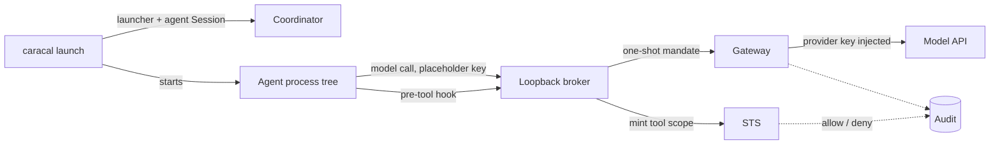

`caracal launch` runs a supported agent, such as Claude Code, inside a Caracal-governed runtime. The agent receives no Caracal credential and no provider credential. Its model calls go through a loopback broker to the Gateway, which injects the provider key, and each tool call the agent is about to make is decided by Caracal first. The agent runs under a delegated agent Session, so terminating or revoking that Session stops the agent and every process it started.

Use it for coding and autonomous agents that you run as CLIs and cannot rebuild around an SDK. For a script that only needs provider credentials in its environment, use [`caracal run`](/guides/runtime-run/); for your own services, use an SDK transport.



## What is enforced

| Agent action | Governed by | Notes |
| --- | --- | --- |
| Model calls | Gateway and STS on every request | The agent only holds a placeholder key; the Gateway injects the provider key. Revocation applies on the next request. |
| Built-in and MCP tool calls | A tool-scope mint at STS before the tool runs | Grants, delegation narrowing, revocation, and audit apply. Unknown tools are denied. |
| Agent lifetime | Session heartbeat | A terminated or revoked Session stops the agent's whole process tree within one heartbeat interval (5 seconds). |
| Switching hooks off | Launcher | `--bare`, `--settings`, and `--setting-sources` are refused for Claude Code, and the launcher's own settings pin `disableAllHooks` to `false`, which outranks any project, local, or user settings file the agent could write. |
| Network access and file reads by an allowed command | Not governed | A shell command the agent is allowed to run can reach the network and read files the user can read. Treat tool scopes as limits on what the agent may attempt, not as a sandbox. |

Tool hooks are cooperative: they run inside the agent. Caracal answers every hook with an explicit decision and denies on any error, because agents run the tool when a hook fails. The credential boundary does not depend on hooks: the agent never holds a credential worth stealing.

## Prepare the zone

1. Run `caracal up` and sign in to the web console.
2. Create an **Application** for the agent, for example `Anton`, and store its client secret owner-only.
3. Create the **model Resource**. For Claude Code with the Anthropic API, use an `api_key` provider that sends the key in the `x-api-key` header, upstream `https://api.anthropic.com`, and declare the operations the agent uses:

   | Method | Path |
   | --- | --- |
   | `HEAD` | `/api/hello` |
   | `POST` | `/v1/messages` |
   | `POST` | `/v1/messages/count_tokens` |

4. Create the **tools Resource**, for example `resource://claude-code-tools`, with one scope per tool the agent may use, named `tool:<ToolName>`: `tool:Read`, `tool:Edit`, `tool:Bash`, `tool:mcp__pipernet__search`. Its upstream is never called; use a provider of kind `none`.
5. Grant the Application the model scope and the tool scopes it should have, then activate the policy. A tool scope that is not granted is denied and audited.

## Write a launch profile

The profile names the Resources and scopes the launcher delegates to the agent Session:

```json title="anton.json"
{
  "model": { "resource": "resource://anthropic", "scopes": ["models:invoke"] },
  "tools": {
    "resource": "resource://claude-code-tools",
    "scopes": ["tool:Read", "tool:Edit", "tool:Bash", "tool:Grep", "tool:Glob"]
  }
}
```

`labels` is optional and defaults to the Application id, which is the role the console's grant authoring uses.

## Launch the agent

```bash
export CARACAL_ZONE_ID=<zone_id>
export CARACAL_APPLICATION_ID=<application_id>
export CARACAL_APP_CLIENT_SECRET_FILE=~/.config/caracal/anton-client-secret
caracal launch claude-code --profile anton.json -- -p "fix the failing test"
```

Everything after `--` goes to the agent unchanged. Interactive sessions work the same way without `-p`. The launcher prints the agent Session id on stderr; that is the id to terminate. Its exit code is the agent's.

## Stop an agent

Terminate the agent Session from the web console or through the Coordinator. Within one heartbeat the launcher stops the agent and its subprocesses, and any model call or tool decision already in flight is refused by STS.

## Validate the launch

| Check | How |
| --- | --- |
| Model traffic is brokered | The agent's environment shows `ANTHROPIC_API_KEY=caracal-gateway-injected`; no `CARACAL_*` variable is present. |
| A tool is denied | Remove a tool scope from the grant; the launcher prints `caracal: denied <Tool>` and the agent reports the denial. |
| Decisions are audited | Web console **Audit** shows `token_exchange` allow and deny events for `resource://claude-code-tools`. |
| The kill switch works | Terminate the agent Session; the launcher prints `stopping claude-code: agent Session ended` and exits 143. |
